# pcmigrate

`pcmigrate` is a CLI that moves customer data from pgvector and OpenSearch into Pinecone. It runs inside the customer's AWS account, stages data in S3, loads it with Pinecone bulk import, and, for sources that stay live during the migration, keeps Pinecone current through an optional buffered change path until cutover.

Every run stops after introspection and publishes a findings report. Nothing is created or moved until a Pinecone field engineer (FDE) approves the proposed plan.

## Scope

The tool ships in three capability waves:

| Wave | Source signals | Pinecone target | Import file |
| --- | --- | --- | --- |
| 1. Dense | pgvector `vector`, `halfvec`; OpenSearch `knn_vector` | Vector index (dense) | Parquet: `id`, `values`, `metadata` |
| 2. Hybrid | Wave 1 plus pgvector `sparsevec`; OpenSearch `rank_features` / neural sparse fields | Document index with `dense_vector` + `sparse_vector` fields | JSONL / JSONL.gz |
| 3. FTS | PostgreSQL `tsvector` columns and GIN text indexes; OpenSearch `text` fields and analyzers | Document index with `full_text_search` string fields, API 2026-07 | JSONL / JSONL.gz |

Sources are built in order: pgvector first, then OpenSearch.

**Goals**

- One CLI that takes a migration from introspection to cutover for a supported source.
- An introspection report an FDE can approve, edit, or reject before any write.
- Restartable stages: any failure resumes from the last checkpoint, not from zero.
- Provable correctness: counts, sampled fidelity, recall, and an id-level diff before cutover.
- New sources added by implementing one connector interface.

**Non-goals for v1**

- Re-embedding data or changing embedding models.
- Rewriting the customer's query layer. Query mappings are documented, application code is not rewritten.
- OpenSearch aggregations, dashboards, ingest pipelines, or security roles.
- Pinecone indexes on GCP or Azure. S3 import only works into AWS-hosted indexes.

## High-level design and architecture

A single orchestrator runs a gated, checkpointed stage pipeline. Source connectors sit behind one interface. Everything from the canonical S3 zone onward is shared across sources.

```mermaid
flowchart LR
    classDef control fill:#eef3ff,stroke:#3b5bdb,color:#1b1f23
    classDef aws fill:#fff8e6,stroke:#b8860b,color:#1b1f23
    classDef s3 fill:#f3f4f6,stroke:#6b7280,color:#1b1f23
    classDef pc fill:#e6f7f1,stroke:#0f9d58,color:#1b1f23
    classDef opt stroke-dasharray: 5 3

    subgraph CP["Control plane (FDE laptop or runner)"]
        direction LR
        I["introspect<br/>read-only discovery"]:::control
        R["report.html<br/>mapping.yaml<br/>plan.lock"]:::control
        A["approve<br/>hash-locked gate"]:::control
        I --> R --> A
    end

    subgraph ACC["Customer AWS account and VPC"]
        direction LR
        SRC[("Source<br/>pgvector or OpenSearch")]
        subgraph FULL["Full load"]
            direction LR
            EX["export<br/>shared snapshot<br/>PK-range partitions"]:::aws
            RAW[("S3 raw/<br/>canonical/")]:::s3
            TR["transform<br/>pre-validate<br/>rejects + duplicates"]:::aws
            IMP[("S3 import/<br/>Parquet or JSONL")]:::s3
            EM["emit"]:::aws
            EX --> RAW --> TR --> EM --> IMP
        end
        subgraph CHG["Change path (optional, tier none skips it)"]
            direction LR
            CDC["change capture<br/>watermark · outbox · logical"]:::aws
            DW["dual-write<br/>SDK shim or HTTP"]:::aws
            BUF[("SQS FIFO buffer")]:::aws
            AP["applier<br/>collapse per id<br/>upsert + delete"]:::aws
            CDC --> BUF
            DW --> BUF
            BUF --> AP
        end
        MAN[("S3 manifest/<br/>state · lock · approvals · events")]:::s3
        SRC --> EX
        SRC --> CDC
    end

    subgraph PC["Pinecone"]
        direction TB
        IDX[("Index + namespaces")]:::pc
        BI["bulk import<br/>error_mode=abort"]:::pc
        VAL["validate<br/>counts · fidelity · recall<br/>filters · id diff"]:::pc
        CUT["cutover<br/>shadow reads · final reconcile"]:::pc
        BI --> IDX --> VAL
    end

    A -. "every later stage checks plan.lock" .-> EX
    IMP -- "storage integration" --> BI
    VAL -. "only after validate passes" .-> AP
    AP --> IDX
    VAL --> CUT
    CUT --> IDX
    EX -.-> MAN
    TR -.-> MAN
    AP -.-> MAN
```



The top row is the control plane. Introspection is read-only, and the FDE approves one hash that every later stage checks. The lower lanes run in the customer's account: the full load lands through bulk import from the S3 staging zones, and changes wait in the buffer until validation passes, because import can't write into an existing namespace. With `change_capture.tier: none` the change path is never provisioned and the run goes from validate straight to cutover, where the final reconcile still runs. The manifest in S3 holds the stage state, the single-writer lock, approvals, and the event log, so any host can resume a run.

## Components

| Component | Responsibility | Shared or per source |
| --- | --- | --- |
| Orchestrator (`core/`) | Stage state machine, S3 manifest and lock, resume, event bus | Shared |
| Source connector (`sources/<kind>/`) | `introspect`, `plan_partitions`, `export`, `change_feed` | Per source |
| Canonical writer | One Parquet schema for dense, sparse, text, and metadata | Shared |
| Emitters (`targets/emitters/`) | Canonical to vector-index Parquet or document-index JSONL | Shared |
| Index manager and importer | Create or adopt the index, start and poll imports, batch by limits | Shared |
| Validator | Counts, fidelity, recall, filters, id diff, hybrid and FTS overlap | Shared, with per-source ground truth |
| Buffer and applier | Durable change queue, collapse per id, upsert and delete | Shared |
| Write path (`writepath/`) | SDK shim and HTTP endpoint for customer dual-writes | Shared |
| Infra (`infra/`) | Pulumi stacks: base, pgvector runner, OpenSearch OSIS and Glue | Base shared, add-ons per source |

## Stage lifecycle

Stages run in order: `introspect → approve → provision → prepare_index → export → transform → emit → import → validate → sync → cutover → teardown`.

- `introspect` and `approve` need no infrastructure, so an FDE can run them from a laptop with network access to the source.
- `provision` onward runs on the runner inside the VPC.
- `sync` is skipped when change capture is off; otherwise it runs continuously until `cutover --confirm`.

## Getting started

```sh
uv sync                      # Python 3.12 environment with all dependencies
uv run pcmigrate --help      # introspect, approve, run, status, resume, teardown
docker compose up -d --wait  # pgvector (pg16) on :5432 and OpenSearch 2.x on :9200, seeded
uv run pytest                # unit tests, plus integration tests when compose is up
```

Before every commit run `uv run ruff check`, `uv run mypy src infra`, and `uv run pytest -m "not integration"`. See `CLAUDE.md` for the full conventions.

## Further reading

- [Design, ADRs, and build plan](docs/design.md), the approved design this repo implements
- [Architecture decision records](docs/adr/README.md), one file per ADR
- [Implementation phases](docs/implementation-phases.md)
- [Testing a migration in laptop mode](docs/runbooks/laptop-mode-test.md), a 30-minute end-to-end walkthrough
- [Manual live test](docs/runbooks/manual-live-test.md), the same plus full-stack mode and change capture under live writes
